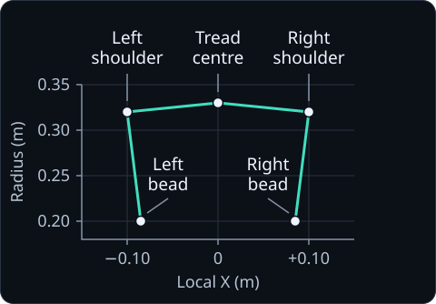
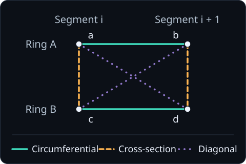

# 001 — Tyre topology

A node marks a point in the tyre, and a beam records which two points will exchange force. Starting with rest geometry lets us check the connections before adding masses and forces. The rest length of a beam is the distance between its two endpoints in this initial geometry. In the next step, the elastic beam model will use the difference between current and rest length to determine whether a beam is stretched or compressed.

## Revolve the cross-section

The plot shows the section at one angle, with radial distance measured away from the axle. Each point becomes a ring when revolved about local X. A bead is the part of the tyre that seats on the rim. The shoulders mark the edges of the tread.

| Ring | X position (m) | Radius (m) |
| --- | ---: | ---: |
| Left bead | −0.085 | 0.20 |
| Left shoulder | −0.10 | 0.32 |
| Tread centre | 0 | 0.33 |
| Right shoulder | +0.10 | 0.32 |
| Right bead | +0.085 | 0.20 |

With `N` segments, segment `i` sits at angle `θ = 2πi/N`. Its coordinates within a ring are `(x, radius × cos θ, radius × sin θ)`. Segment zero is on the positive Y side of the axle. Each ring stores exactly `N` nodes, with index `ring × N + segment`. To close the ring, the generator uses `(i + 1) % N` for the next segment.

## Connect one panel

Take two neighbouring rings and two successive angular segments. Together they make one panel.

- **Circumferential** beams `a–b` and `c–d` follow the two rings.
- **Cross-section** beams `a–c` and `b–d` join the rings at the same angle.
- **Diagonal** beams `a–d` and `b–c` brace the panel. When the panel skews sideways, one diagonal tends to lengthen while the other shortens. The future beam forces will resist this change of shape.

Around the full tyre, each of the five rings contributes one circumferential beam per segment. Each of the four neighbouring ring pairs contributes one cross-section beam and two diagonals per segment. Counting each connection once gives `5N` nodes and `5N + 4N + 8N = 17N` beams. At `N = 32` that gives **160 nodes and 544 beams**.

## Inspect the result

1. Run `cargo run -p vehicle_lab -- --inflation-lab` from the workspace root.
2. Press **3** to hide diagonals. Hold the left mouse button and drag to see the four bands of panels between the five rings.
3. Press **2** to isolate the circumferential beams. Zoom in and find the two larger dots on each ring. They mark the seam from segment 31 to segment 0. Follow the beam between those dots, then restore **2** and **3** to see how the other beam families continue around the seam.
4. Run `cargo test -p vehicle_physics`. The tests check the counts, the specific seam connections, rest lengths, left/right symmetry, and invalid configurations. The three-segment case checks the smallest closed rings.

The next experiment fixes the two bead rings, presses a tread patch, and measures its rebound after release. [002 — Elastic carcass](../002-elastic-carcass/README.md)
