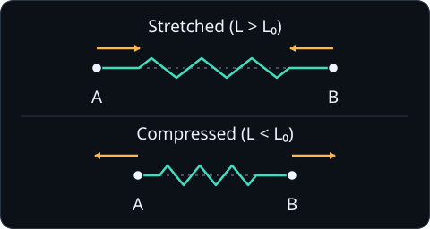
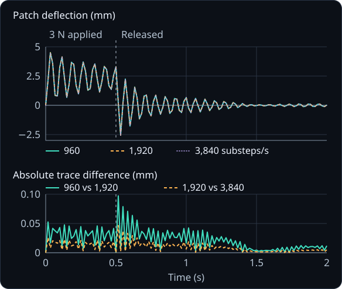

# 002 — Elastic carcass

The topology from milestone 001 specifies which nodes a beam connects. This step lets those nodes move. The lab fixes both bead rings at their rest positions and presses the tread while the three other rings deform.

## Turn each beam into a spring and damper

Let `L₀` be the beam's rest length, `L` its current length, and `u` the unit vector from endpoint A to endpoint B. The spring term `k(L − L₀)` is positive in tension and negative in compression. The damper adds `c(vB − vA)·u`, which opposes changes in length. The force on A is `u[k(L − L₀) + c(vB − vA)·u]`, and B receives the opposite force.

The solver accumulates all beam and external forces from the current positions and velocities before advancing any node. Each free node takes a semi-implicit Euler step. Update velocity with `v += (F/m) × dt`, then advance position with the new velocity using `x += v × dt`. The two bead rings act as a fixed fixture. For this mesh the 8 kg mass gives 0.05 kg per node, including the fixed nodes. The beam lengths used by the solver come from the same double-precision distance calculation at rest and during a step, so an unloaded tyre at rest has zero spring force.

## Press and release the top tread

The replay starts at rest with gravity off. From 0 to 0.5 s it applies 1 N along local −Y to each of the three tread-centre nodes at segments 31, 0, and 1. The total is 3 N. At 0.5 s the load goes to zero, and the solver advances to 2 s. The deflection is the mean drop in Y across the patch. Positive values mean inward motion, and negative values mean the patch has moved past rest.

The light load keeps this uninflated carcass experiment in a small-deflection range. The mass and beam coefficients are illustrative values for this mesh. An inflated tyre spreads loads through pressure as well as the carcass, so the force and displacement here describe the bench experiment.

| Substeps/s | Peak inward (mm) | At release (mm) | Outward rebound (mm) | Residual at 2 s (mm) |
| ---: | ---: | ---: | ---: | ---: |
| 960 | 4.6028 | 3.2900 | 2.5778 | +0.0260 |
| 1,920 | 4.6020 | 3.2910 | 2.5752 | +0.0142 |
| 3,840 | 4.6016 | 3.2910 | 2.5744 | +0.0092 |

The table uses every substep to find the peaks. The plot and timestep comparison sample all three runs at the same 60 Hz times. The largest difference drops from **0.0972 mm** for 960 vs 1,920 substeps/s to **0.0465 mm** for 1,920 vs 3,840. All three runs rebound past rest and finish within 0.25 mm of it.

## Reproduce the checks

1. Run `cargo test --workspace` from the workspace root. The tests cover spring and damping force directions, equal and opposite endpoint forces, unloaded equilibrium, fixed beads, repeatability after reset, and preservation of state when a step fails.
2. Run `cargo run -p vehicle_lab -- --elastic-report` to reproduce the measurements and check the timestep comparison without opening a window.
3. Run `cargo run -p vehicle_lab` and press **Enter**. Watch the load change from 3 N to zero and the signed deflection oscillate around zero. Zoom in on the pink nodes and compare their motion with the grey crosses. Hold **Space**, toggle a beam family with **1–3**, release **Space**, and press **Backspace** to return to rest.

The next milestone adds a closed pressure surface and compares the tyre's response at several inflation pressures. [Remaining milestones](../README.md#planned)
