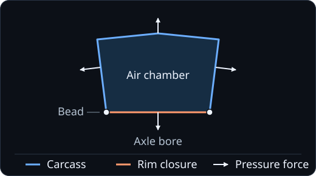
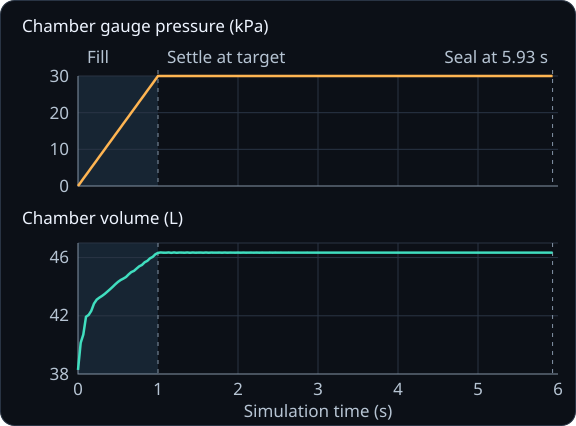
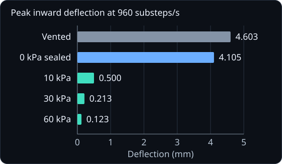
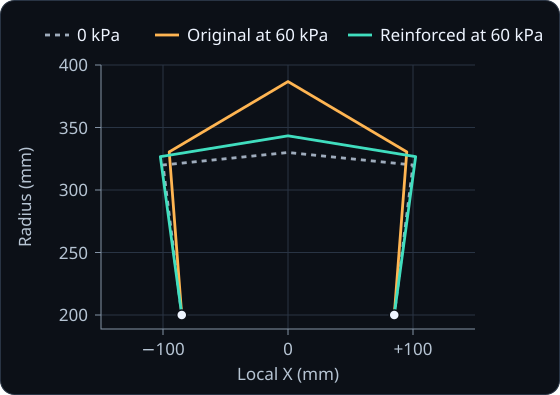

# 003 — Inflation and tread reinforcement

The lab opens with a sealed tyre at **0 kPa gauge**. Its air starts at the same pressure as the surroundings. When the tread is pressed inward and the volume falls, the trapped air develops positive gauge pressure. Selecting a higher preset lets you watch the carcass grow as the chamber fills. Testing the original carcass exposed an exaggerated crown bulge, which the current lab controls with a reinforced tread band.

## Close the chamber against the rim

Two triangles cover each panel between neighbouring rings. The default 32-segment carcass contributes 256 triangles. A cylindrical strip of 64 triangles connects the right bead ring back to the left and seals the chamber around the open axle bore. The two sidewalls use mirrored diagonals so triangulation preserves left/right symmetry.

Triangle winding defines which way is out. The solver adds the signed tetrahedral volumes formed by each oriented face and a common reference point. Each face receives a force equal to its outward area vector multiplied by the gauge pressure. A third of that force goes to each vertex. The closure contributes both volume and pressure forces, and its vertices share the fixed bead fixture.

## Fill, settle, then seal

The gas model holds temperature constant. The product of **absolute pressure and chamber volume** represents the gas charge. While the valve is open, the lab sets the charge from the requested gauge pressure and current volume. It ramps the request over 1 s, then holds it at the target while the carcass settles. Once every free node has stayed slower than 0.1 mm/s for 0.25 s, the valve closes.

After sealing, the charge stays fixed. The solver divides charge by the current volume, then subtracts the ambient pressure of 101,325 Pa to get the gauge pressure used for forces. In the original carcass run at 30 kPa, the chamber volume grows from 38.277 L to 46.339 L and seals at 5.932 s.

## Compare tread presses from the sealed baseline

Each run applies the same 3 N load for 0.5 s and advances to 2 s. Deflection is the mean drop in Y of the three tread nodes from their unloaded positions after sealing. Measuring from the original mesh would count inflation growth as part of the tread response. Replay and reset restore the recorded node positions, velocities, and gas charge.

The original carcass measurements isolate the effects of sealing and raising the pressure.

| Substeps/s | Preset | Settled gauge (kPa) | Volume (L) | Seal time (s) | Peak inward (mm) | At release (mm) | Residual at 2 s (mm) |
| ---: | --- | ---: | ---: | ---: | ---: | ---: | ---: |
| 960 | Vented | 0 | 38.277 | — | 4.6028 | 3.2900 | +0.0260 |
| 960 | Sealed 0 kPa | 0 | 38.277 | 0.000 | 4.1046 | 2.5553 | +0.0585 |
| 960 | 10 kPa | 10 | 43.539 | 5.800 | 0.5000 | 0.2368 | +0.0029 |
| 960 | 30 kPa | 30 | 46.339 | 5.932 | 0.2133 | 0.1065 | −0.0001 |
| 960 | 60 kPa | 60 | 50.736 | 3.413 | 0.1231 | 0.0702 | +0.0001 |
| 1,920 | Vented | 0 | 38.277 | — | 4.6020 | 3.2910 | +0.0142 |
| 1,920 | Sealed 0 kPa | 0 | 38.277 | 0.000 | 4.1026 | 2.5931 | +0.0512 |
| 1,920 | 10 kPa | 10 | 43.539 | 5.772 | 0.5000 | 0.2369 | +0.0028 |
| 1,920 | 30 kPa | 30 | 46.339 | 5.897 | 0.2113 | 0.1184 | −0.0034 |
| 1,920 | 60 kPa | 60 | 50.736 | 3.353 | 0.1230 | 0.0746 | −0.0001 |

For the vented row, volume is the geometric volume of the unloaded carcass. With the chamber sealed at the same initial gauge pressure, peak deflection falls by 0.4982 mm at 960 substeps per second. Peak deflection decreases across the positive presets at both rates. The largest peak difference when halving the timestep is 0.0020 mm, below the 0.10 mm check.

## Stiffen the tread band

At 60 kPa, the original spring network let the tread centre grow radially by 56.7 mm while the shoulders grew by 10.5 mm. The resulting crown bulge came from loading the whole carcass with pressure while giving the tread the same circumferential stiffness as the other rings. A radial tyre uses separate crown reinforcement alongside the carcass plies. [Michelin’s tyre construction guide](https://www.michelin.com.sg/auto/advice/tyre-basics/tyre-manufacturing-recycling)

The lab now multiplies the circumferential stiffness of the shoulder and tread-centre rings by 20. It doubles the stiffness of the cross-section and diagonal beams running between those rings. This lets the sidewalls flex on their original springs.

Each segment also gets a spring that controls the distance from the tread-centre node to the midpoint of its two shoulder nodes. It applies a force toward or away from that midpoint, and each shoulder receives half the opposite force. The two shoulder forces combine at their midpoint and balance the tread-centre force along the same line. That gives zero net force and torque. The spring uses 30,000 N/m stiffness and 5 N·s/m damping. Its distance is smoothed over one micrometre so it remains finite when the crown flattens.

## Compare the settled shapes

The overlay uses measured coordinates at segment zero and equal scales on both axes. All three profiles share the same fixed bead positions.

| Carcass at 60 kPa | Crown growth (mm) | Shoulder growth (mm) | Shoulder width change (mm) | Volume (L) | Peak 3 N deflection (mm) |
| --- | ---: | ---: | ---: | ---: | ---: |
| Original | 56.742 | 10.486 | −9.954 | 50.736 | 0.1231 |
| Reinforced | 13.341 | 6.678 | +4.227 | 42.786 | 0.0476 |

Both cases use 3,840 substeps per second. Growth is the maximum radius increase from the original mesh across each relevant ring. Width change is the largest signed change in shoulder spacing at a shared angle. The reinforced tyre meets the bench limits of 15 mm crown growth and 8 mm absolute width change. Its peak under the light tread press is about 0.05 mm, which the lab records in **Peak press** so it can be read after release.

The stiffer springs require a smaller timestep with the semi-implicit Euler solver. At 3,840 and 7,680 substeps per second, all presets settled and their crown growth and peak deflection agreed within 0.001 mm. These coefficients and limits describe a generic bench model. The ground-contact experiment will let us assess a distributed load across the tread.

## Reproduce the checks

1. Run `cargo test --workspace` to check face winding, volume, pressure forces, fixed beads, failed-step rollback, replay from a sealed baseline, and reinforcement at rest and under deformation.
2. Run `cargo run -p vehicle_lab -- --inflation-report` for the original carcass measurements and `cargo run -p vehicle_lab -- --elastic-report` to reproduce milestone 002.
3. Run `cargo test -p vehicle_lab fill_ramps_then_seals_at_target -- --nocapture` to print the 30 Hz fill trace and the final seal sample. Each `TRACE` row gives time in seconds, gauge pressure in kPa, and volume in litres.
4. Run `cargo run -p vehicle_lab -- --radial-report` for the comparison, including the segment-zero coordinates used in the SVG.
5. Run `cargo run -p vehicle_lab -- --inflation-lab` and press **P** until the target is 60 kPa. Press **P** during a fill to start the next preset from zero. After the tyre seals, press **Enter** and read **Peak press** after the replay, or hold **Space** to press the tread manually. Press **4** to show the pressure surface and **Backspace** to restore the sealed baseline.

The next milestone couples the reinforced tyre to a rigid rim and introduces ground contact. [004 — Rim and ground contact](../004-rim-and-ground-contact/README.md)
