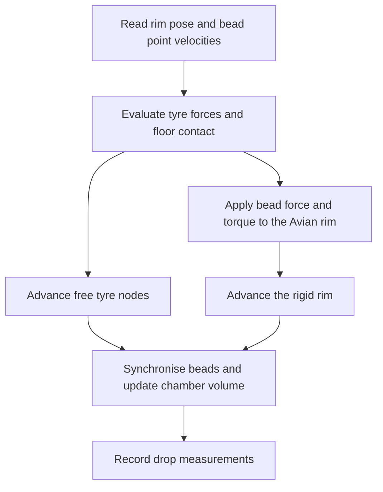
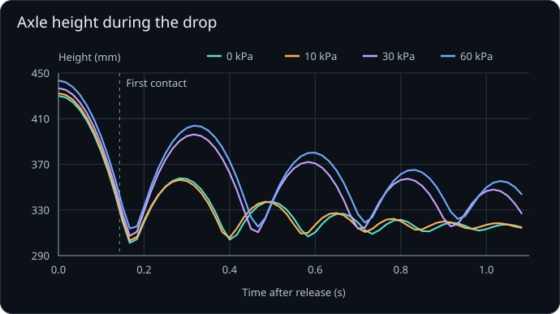
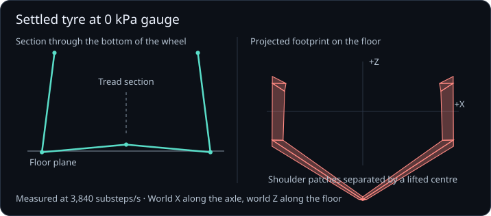

# 004 — Rim and ground contact

The fixed-bead press in [milestone 003](../003-inflation/README.md) measured how inflation and tread reinforcement change the tyre under a small load. This step mounts that tyre on a moving rim and drops the complete wheel. The floor reaction and the tyre's deformation now determine how the axle moves.

## Coupling the tyre and rim

The rim is an Avian dynamic body with its centre of mass on the axle. The 12 kg bare rim is a thin hoop at the bead radius. Each bead node acts as a point mass carried by the rim. Together the two bead rings add 3.2 kg and contribute to the rim's rotational inertia. The other 4.8 kg is distributed across the free tyre nodes. Avian applies gravity to the rim and its beads, and the tyre solver applies gravity to the free nodes. The assembled wheel weighs 196.2 N.

The tyre solver evaluates beams, crown springs, and pressure in world coordinates. The bead velocity is the rim's linear velocity plus angular velocity crossed with the bead's offset from the rim centre. This matters for beam damping, which depends on the endpoints' relative velocity. The forces already acting on the bead nodes, including the pressure on the rim closure, are summed into a force and a torque about the rim centre. Avian applies that wrench as an impulse over the same substep that advances the free nodes. [Avian substep schedule](https://docs.rs/avian3d/0.8.0/avian3d/dynamics/solver/schedule/struct.SubstepSchedule.html)



## Contact with the floor

Each tread-centre and shoulder node below the floor gets an upward penalty force. A spring with stiffness 35,000 N/m pushes in proportion to penetration. A damper of 150 N·s/m dissipates energy on impact. The result is clamped at zero, so the floor can push a node up and releases it when it rises fast enough. The rim carries no collider in this experiment. The normal reaction comes from the tread, through the beams and beads.

With the initial 80,000 N/m floor stiffness, the 30 kPa wheel failed the 10 s settling check even though the floor supported its weight. A more compliant contact spring gives the floor damper more travel over which to dissipate energy. The drop bench also uses three times the axial beam damping of the fixed-bead press. The carcass stiffness, mesh, and crown spring match the reinforced tyre in milestone 003.

The contact patch is estimated by clipping the tread triangles below the plane and projecting the clipped polygons onto it. Length is the span along Z and width is the span along X. Those dimensions depend on the 32-segment mesh and the small penetration the penalty force needs to support the wheel.

## Measured results

All four presets contacted the floor in 142.71 ms at 3,840 substeps/s and 142.84 ms at 7,680 substeps/s. The 100 mm free-fall prediction is 142.78 ms. Doubling the step rate changed the settled axle height by at most 0.07 mm and the first rebound rise by at most 0.23 mm.

| Initial gauge (kPa) | First rebound (mm) | Settled axle height (mm) | Patch L × W (mm) | Mean floor force (N) | Max penetration (mm) | Settled after (s) |
| ---: | ---: | ---: | ---: | ---: | ---: | ---: |
| 0 | 58.25 | 315.87 | 137.40 × 200.40 | 195.78 | 9.77 | 2.48 |
| 10 | 54.75 | 316.79 | 96.95 × 201.24 | 195.73 | 9.34 | 2.20 |
| 30 | 90.60 | 328.02 | 136.97 × 80.91 | 196.08 | 10.39 | 3.48 |
| 60 | 92.49 | 334.93 | 137.82 × 66.12 | 196.03 | 12.57 | 3.35 |



At 0 kPa, the loaded tread centre lifts above the plane and the two shoulders carry the load. At 30 and 60 kPa, the footprint is concentrated around the centre tread. The projected footprint therefore spans both shoulder bands at low pressure, including the gap between them. The split footprint and the 12.6 mm peak penetration show where this coarse model and compliant floor limit comparisons with a real tyre.



## Reproduce the drop

```sh
cargo test --workspace
cargo run -p vehicle_lab -- --drop-report
cargo run -p vehicle_lab -- --drop-report --samples
cargo run -p vehicle_lab
```

The report prepares and seals the same pressure presets as the lab. Each wheel starts with its lowest tread point 100 mm above the floor. The first sample with the tread below the plane marks first contact. The first rebound rise is the axle's first peak above its first minimum after contact. The run settles after the axle stays below 0.01 m/s of vertical speed for 0.5 s and the mean floor force over that window is within 2% of the wheel's weight. The report checks both step rates against the 143 ms ballistic contact prediction and compares settled height and rebound across rates.

In the lab, press **Enter** to drop the wheel at the default 0 kPa gauge, **P** to prepare the next pressure preset, and **Backspace** to return the wheel to release height. Run with `--inflation-lab` to revisit the fixed-bead press.
