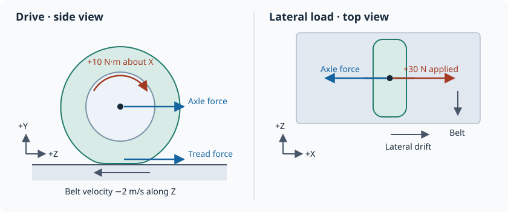
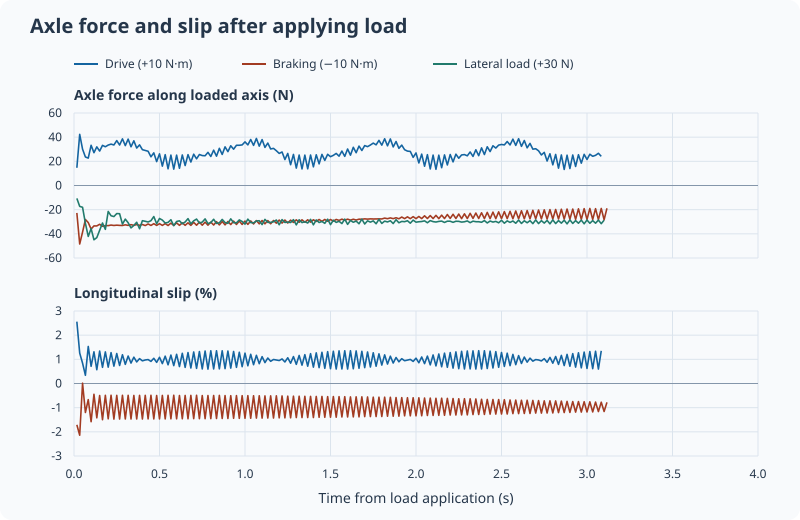

# 005 — Rolling and grip

The tyre from [milestone 004](../004-rim-and-ground-contact/README.md) could support the rim on a floor and rebound after a drop. This step uses a moving belt to measure the forces that reach the axle when the wheel drives, brakes, or moves sideways.



## From tread slip to axle force

The floor still pushes upward on penetrated tread and shoulder nodes. For each supported node, friction opposes the horizontal node velocity relative to the surface. Its magnitude is `μ N tanh(s / v₀)`, where `N` is that node's normal force, `s` is its slip speed, and `v₀` is the transition speed. The rig uses `μ = 0.8` and `v₀ = 0.1 m/s`. Both horizontal directions share the same force limit, so diagonal slip cannot get the full limit twice.

Near zero slip, the friction law acts like a stiff damper on each 50 g node. In the first implementation, applying this force directly from the start-of-step slip produced 11.1% drive slip at 3,840 substeps/s and 1.3% at 7,680 substeps/s. The solver now predicts the node velocity from the other forces, then solves for the friction force using the slip speed that remains after applying that force over the substep. The scalar solve bounds the impulse so friction alone cannot reverse the predicted slip.

Contact forces act on the tread. The beads transfer the resulting forces and torque to the Avian rim. The report measures both the floor force and the bead force on the rim. In steady rolling their mean horizontal components nearly agree. During a transient the free nodes can gain or lose momentum between the floor and axle.

## Establish the baseline

Seal the reinforced tyre at 30 kPa gauge and settle the 20 kg assembly on the stationary belt. Then start the belt at −2 m/s along Z. The rig locks longitudinal travel, yaw, and camber. Heave, lateral travel, and spin about X are free. Free-rolling spin about +X moves the bottom of the tread toward −Z. Forcing faster spin moves the tread backward relative to the belt and produces a reaction along +Z.

Save the free-rolling state and calculate the effective rolling radius from belt speed divided by the mean spin. Each case starts from that saved state. Longitudinal slip is `(spin × effective radius) / belt speed − 1`. Lateral slip angle is `atan2(lateral axle speed, forward axle speed relative to belt)`. A positive slip angle points toward +X.

The bench lets each case run for one second before averaging over complete revolutions. It uses two consecutive turns when their mean spins differ by at most 0.5%, their slip angles differ by at most 0.10°, their axle forces differ by at most 1.5 N, and each turn supports the wheel within 2% of its weight. A case fails if it cannot meet those checks in 12 seconds.

## Measured results

At 3,840 substeps/s the effective rolling radius was 335.51 mm and the mean normal support was 196.20 N in every case.

| Case | Spin (rad/s) | Longitudinal slip (%) | Slip angle (°) | Axle Z (N) | Axle X (N) |
| --- | ---: | ---: | ---: | ---: | ---: |
| Free rolling | 5.961 | 0.000 | 0.000 | −2.42 | 0.00 |
| Drive | 6.019 | +0.973 | 0.000 | +27.40 | 0.00 |
| Braking | 5.903 | −0.978 | 0.000 | −32.27 | 0.00 |
| Lateral load | 5.961 | 0.000 | +0.637 | −2.43 | −30.00 |

The unloaded wheel shows about 2.4 N of rolling resistance. That drag offsets the drive and braking forces toward −Z. With the lateral load, the axle moves toward +X at about 22 mm/s while the tyre balances the applied 30 N. At 7,680 substeps/s the effective radius was 335.48 mm and the largest change in mean horizontal axle force was about 0.35 N.



The plot uses the 60 Hz samples from the lab-rate runs. The force curves show Z for drive and braking and X for the lateral run. The regularized friction law requires some local slip to sustain a horizontal force. The coarse tread and compliant floor also affect the force ripple and rolling resistance. These measurements characterize this tyre and belt model at one speed, pressure, and load.

## Reproduce the experiment

```sh
cargo test --workspace
cargo run -p vehicle_lab -- --drop-report
cargo run -p vehicle_lab -- --rolling-report
cargo run -p vehicle_lab -- --rolling-report --samples
cargo run -p vehicle_lab -- --rolling-lab
```

Use keys **1** through **4** to select a case, **Enter** to run or replay it, and **Backspace** to return to the baseline. The report runs the same bench at 3,840 and 7,680 substeps/s. It checks force and slip direction and compares the results within 0.01 slip ratio, 0.5° slip angle, and 5 N horizontal axle force.
