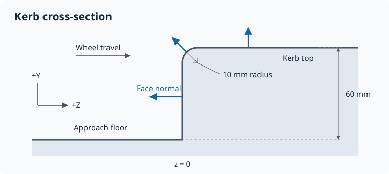
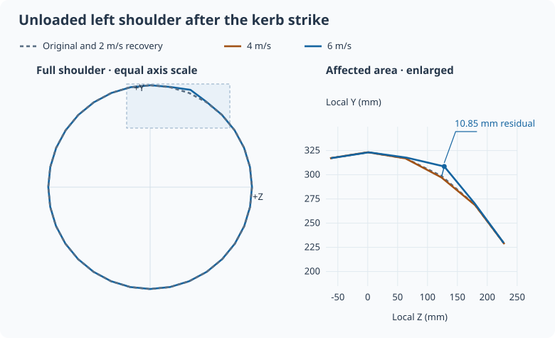

# 006 — Impact and damage

The rolling rig measured how the tyre transmits grip to the axle. This step coasts the same reinforced tyre into a kerb and compares the shape at impact with the shape after unloading. The wheel starts at 30 kPa gauge and carries its gas charge through both phases.

## Contact and material



The Avian rim can move forward and vertically and spin about X. Each run starts from the same prepared shape and orientation with the axle 0.85 m before the kerb face. The initial spin is the launch speed divided by the 335.51 mm rolling radius measured in milestone 005. Gravity settles the wheel onto the approach as it coasts. The rig records forward speed immediately before the first substep that applies kerb force.

A tread or shoulder node inside the road gets one reaction based on its depth and the nearest exposed surface. The penalty spring and damper work along the local normal. Friction acts along the surface, with a coefficient of 0.8. The rounded edge turns the normal continuously from backwards at the face to upwards at the top.

| Engineering strain | Tension | Compression |
| --- | ---: | ---: |
| Yield | 10% | 9% |
| Fracture | 35% | 12% |

The original length sets the strain scale. When the elastic strain exceeds yield, the material changes its stress-free length to leave an elastic extension or compression at the yield limit. Subsequent unloading retains the resulting plastic set. Total strain relative to the original length triggers fracture, which permanently removes the beam's spring and damper. Material changes commit alongside a valid geometry step, and broken beams retain their topology indices.

The first calibration runs produced about 11.05% peak compression at 4 m/s and 12.86% at 6 m/s with the fracture limit out of reach. A 12% compression fracture limit places the transition between those cases at both solver rates. The limits are illustrative material settings for this rig.

## Measure the residual shape

The bench measures inward displacement by comparing each node with the same node on the prepared tyre in rim-local coordinates and projecting the difference onto its original radial direction. It takes the maximum from first kerb contact through capture 0.45 s later. The flat-road control records its peak over the 0.85 s coast.

At capture, the bench subtracts the rim's translational and rotational velocities, then lets the tyre relax on fixed beads without road contact or gravity. The recovered shape is recorded once every node has stayed below 0.5 mm/s for 0.25 s. Residual displacement is the largest distance between matching original and recovered nodes in any direction.

## Results

These are the results at 3,840 substeps/s. Yielded counts include any beam that yielded before it broke. The flat-road control shows the deflection caused by supporting the wheel during the coast.

| Run | Launch (m/s) | First kerb contact (m/s) | Peak inward (mm) | Residual (mm) | Yielded | Broken |
| --- | ---: | ---: | ---: | ---: | ---: | ---: |
| Kerb | 2 | 1.975 | 17.26 | <0.001 | 0 | 0 |
| Kerb | 4 | 3.979 | 27.48 | 1.466 | 6 | 0 |
| Kerb | 6 | 5.969 | 31.31 | 10.854 | 6 | 6 |
| Flat control | 6 | — | 8.07 | <0.001 | 0 | 0 |



The 4 m/s strike left a small inward set at the shoulders. At 6 m/s, the pressurized shoulder bulged outward after three beams on each side broke between a bead and shoulder. Doubling the solver rate changed peak inward displacement by at most 0.173 mm and residual displacement by at most 0.003 mm. Both rates broke the same six beams at zero-based topology indices `6, 9, 11, 391, 393, 394`.

## Reuse in vehicle structures

The axial yield rule, persistent fracture, and topology-indexed history can be reused for chassis members. The kerb forces and recovered tyre shape also depend on the compliant tread, crown springs, contact mesh, and sealed air. Those features remain part of the tyre model. The next milestone will link qualifying carcass damage to a leak so pressure loss can be measured over time.

## Reproduce the experiment

```sh
cargo test --workspace
cargo run -p vehicle_lab -- --impact-report
cargo run -p vehicle_lab -- --impact-report --samples
cargo run -p vehicle_lab -- --impact-lab
```

Use **1**, **2**, or **3** to choose the launch speed, **Enter** to strike or replay, and **Backspace** to reset. The headless report repeats the experiment at 3,840 and 7,680 substeps/s and verifies elastic recovery, permanent set, localized fracture, and an undamaged flat-road control at both rates.
