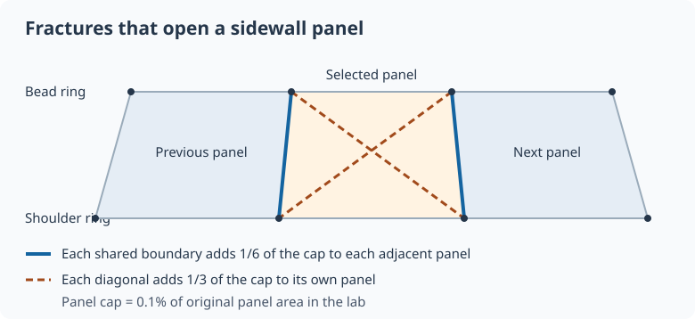
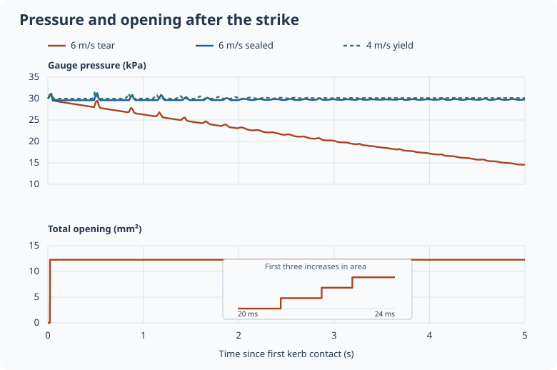
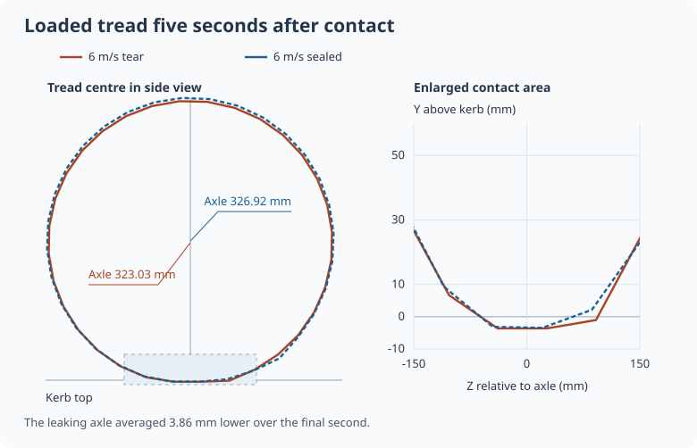

# 007 — Puncture and pressure loss

The sealed kerb experiment in [milestone 006](../006-impact-and-damage/README.md) measured the permanent shape left by six sidewall fractures. This step lets those fractures open pathways for air. The wheel coasts for five seconds after first kerb contact so loss of air can be measured alongside loaded deformation and support.

## Map fractures to openings



A sidewall panel spans one angular segment between a bead and its adjacent shoulder. Each broken bead-to-shoulder boundary contributes one-sixth of the area cap to each adjacent panel. Each broken diagonal contributes one-third to its own panel. The four contributions add to the panel cap and the same rule wraps across the seam on both sidewalls. The lab sets this cap to 0.1% of the undeformed panel area. Computed openings persist because they follow the beam fracture state. The pressure mesh still supplies the closed volume and surfaces that distribute the pressure load.

## Exchange air with the atmosphere

The chamber stores isothermal charge, absolute pressure times volume. At each accepted physics substep the solver evaluates flow at the candidate chamber volume and converts between charge and air mass at 293.15 K. The orifice equation uses the pressure ratio across the opening and the upstream absolute pressure. The lab uses a discharge coefficient of 0.65 and caps the flow at the choked limit. The pressure can drive air in either direction, and one update can at most bring the chamber to ambient at its candidate volume. [NASA mass-flow equations](https://www1.grc.nasa.gov/beginners-guide-to-aeronautics/mass-flow-rate-equations/)

The opening fraction and discharge coefficient are illustrative. They represent an effective airflow area assigned to a damaged panel. The mass-flow calculation uses that area and the current pressure. A compressed tyre can briefly gain gauge pressure while losing air because its volume has fallen.

## Repeat the strike

The bench uses the 30 kPa tyre, 60 mm rounded kerb, 20 kg wheel, and damage settings from milestone 006. Both 6 m/s runs keep structural damage enabled. With airflow enabled, each additional fracture can enlarge the opening. The sealed replay isolates the effect of air loss. The 4 m/s run checks that a tyre with yielded beams retains its air.

| Case at 3,840 substeps/s | Final gauge (kPa) | Opening (mm²) | Air lost (g) | Mean loaded height (mm) | Mean support (N) |
| --- | ---: | ---: | ---: | ---: | ---: |
| 6 m/s, tearing enabled | 14.614 | 12.269 | 8.965 | 325.260 | 194.98 |
| 6 m/s, sealed | 29.814 | 0 | 0 | 329.117 | 191.34 |
| 4 m/s, tearing enabled | 30.144 | 0 | 0 | 328.476 | 195.39 |



The first fractures opened four panels 21.09 ms after contact. Two more events increased the total area to 8.180 mm² at 22.14 ms and 12.269 mm² at 22.92 ms. At fixed volume and 30 kPa gauge, one 3.067 mm² opening initially passes 0.5303 g/s. Two equal openings pass 1.0606 g/s.



The axle sits 3.86 mm lower on average in the leaking run. Loaded heights are averaged over supported substeps with the whole tyre over the top during the final second. Vertical support includes the complete road reaction over that second, including any airborne time. The profiles capture the final substep with world +Y up, X and Z relative to the axle, and Y measured from the kerb top. Doubling the solver rate changed final gauge pressure by at most 0.170 kPa and mean loaded height by at most 0.085 mm.

## Reproduce the measurements

```sh
cargo test --workspace
cargo run -p vehicle_lab -- --impact-report
cargo run -p vehicle_lab -- --puncture-report
cargo run -p vehicle_lab -- --puncture-report --samples
cargo run -p vehicle_lab -- --puncture-lab
```

Use **1** for the tearing strike, **2** for the sealed comparison, and **3** for the yielding case. **Enter** launches or replays the case and **Backspace** resets. The report prints the fixed-volume airflow comparison and checks both solver rates against the expected air loss, loaded height, and wheel support. The plots use the lab-rate CSV traces, event times, and final node positions.
