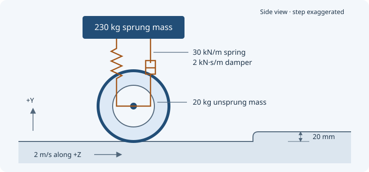

# 008 — Loaded wheel and suspension

The moving-belt rig measured grip at 196.2 N of vertical load. An evenly balanced 1,000 kg car puts **2,452.5 N** on each tyre at rest, about 12.5 times that load. This step checks both how much the tyre deforms at that load and how it supports a simple suspension as it crosses a step.



## Measure the tyre and the road separately

The static fixture guides the upright rim along Y and ramps the added downward force over one second. It applies gravity separately to the 4.8 kg of free tyre nodes. At each load it waits for half a second of axle speed below 5 mm/s and road support within 2% of the target. The unloaded radius is the distance from the axle to the lowest tread point after inflation. Carcass deflection subtracts road penetration from the drop in axle height. Rim clearance uses the bead radius as the radius of the rim.

| Preset | Road load (N) | Unloaded radius (mm) | Axle height (mm) | Carcass deflection (mm) | Road penetration (mm) | Rim clearance (mm) | Footprint (mm) |
| --- | ---: | ---: | ---: | ---: | ---: | ---: | ---: |
| Original, 30 kPa | 196.2 | 336.68 | 328.04 | 4.57 | 4.07 | 128.04 | 137 × 81 |
| Original, 30 kPa | 1,226.2 | 336.68 | 312.01 | 15.52 | 9.15 | 112.01 | 226 × 204 |
| Original, 30 kPa | 2,452.5 | 336.68 | 301.37 | 24.72 | 10.58 | 101.37 | 276 × 204 |
| Light car, 150 kPa | 2,452.5 | 340.19 | 326.14 | 11.59 | 2.47 | 126.14 | 144 × 69 |

The original tyre carries the target weight, but its tread sinks 10.6 mm into the compliant road. The new preset keeps the 32-segment geometry and the beam-and-pressure model. It raises initial gauge pressure to 150 kPa and increases sidewall and tread stiffness to limit shape changes under load. It also raises road stiffness to 500 kN/m per tread node. At 300 kN/m the first version of this preset still penetrated 3.94 mm. The stiffer road brings that down to 2.47 mm while the carcass still deflects 11.59 mm. The selected nominal-load bounds are 10–35 mm of carcass deflection, at most 3 mm of road penetration, and positive rim clearance.

| Light-car parameter | Value |
| --- | ---: |
| Initial gauge pressure | 150 kPa |
| Base circumferential, cross-section, diagonal stiffness | 30, 80, 32 kN/m |
| Base circumferential, cross-section, diagonal damping | 12, 18, 9 N·s/m |
| Tread hoop and brace stiffness multipliers | 16 and 2 |
| Crown spring and damper | 120 kN/m and 5 N·s/m |
| Road stiffness and damping per contacting node | 500 kN/m and 150 N·s/m |
| Road friction coefficient and transition speed | 0.8 and 0.1 m/s |

Pressure is sealed when the unloaded shape settles. At nominal static load it rises to 150.94 kPa. The table gives the original preset at 7,680 substeps/s and the light-car preset at 3,840 substeps/s. The light-car results round to the same axle height and penetration at 7,680 substeps/s. These parameters establish an engineering baseline for the next grip experiment.

## Couple the wheel to the sprung mass

The Avian corner uses a 230 kg sled, a 3 kg hub, a 9 kg bare rim, and an 8 kg tyre. The prismatic joint guides the hub along the chassis-local vertical axis between 60 and 290 mm from the mount. The revolute joint lets the rim spin about its local X axis. The mount is 280 mm below the sled's centre. Avian's `xpbd_joints` feature enables the joint solver for these constraints.

The suspension applies a **30 kN/m** linear spring and **2 kN·s/m** damper between the mount and hub. At each substep, it computes the axial separation and the relative velocity of the mounting points. The resulting impulse pushes the chassis and hub in opposite directions. An offset mount also applies a torque to the chassis. On a flat road, the predicted spring compression is the sprung weight divided by spring stiffness, or **75.21 mm**. The road supports both sprung and unsprung weight.

## Tow it over a step

Start from the same sealed tyre in each case. Settle the assembly for four seconds, then ramp the sled's forward speed to 2 m/s over one second. The tyre's spin follows tread friction. The step begins at Z = 3.5 m, rises 20 mm, and has an 8 mm edge radius. The flat control follows the same tow on a level surface.


| Substeps/s | Static support (N) | Static sag (mm) | Final flat axle height (mm) | Final step axle height (mm) | Peak step suspension travel from sag (mm) | Minimum step-run rim clearance (mm) |
| ---: | ---: | ---: | ---: | ---: | ---: | ---: |
| 3,840 | 2,452.5 | 75.21 | 325.57 | 345.57 | 11.03 | 105.38 |
| 7,680 | 2,452.5 | 75.21 | 325.57 | 345.57 | 11.04 | 105.38 |

The axle starts climbing shortly before it reaches the step face. The body follows, overshoots, then settles. The last second on the step supports an average of 2,451.8 N at the lab rate. The corresponding flat run varies by about 1 mm of suspension travel as the discrete tread nodes exchange contact. The chart samples force at 60 Hz, so its visible peaks describe the sampled trace.

## Reproduce the checks

```sh
cargo test --workspace
cargo run -p vehicle_lab -- --corner-report
cargo run -p vehicle_lab -- --corner-report --samples
cargo run -p vehicle_lab -- --corner-lab
cargo run -p vehicle_lab -- --corner-lab --benchmark
```

The report checks static and final mean support within 2%, sag within 3 mm, positive rim clearance, and a settled rise within 3 mm of the step height relative to flat road. It compares static tyre height within 2 mm and peak step travel within 5 mm across the two solver rates. The CSV contains 60 Hz samples from both cases at both rates. In the lab, press **1** for the flat road or **2** for the step, **Enter** to replay, and **Backspace** to reset.

On the development machine, the windowed step benchmark averaged 3.43 ms of fixed-update CPU time per 60 Hz tick and ran at 1.000× real time.
