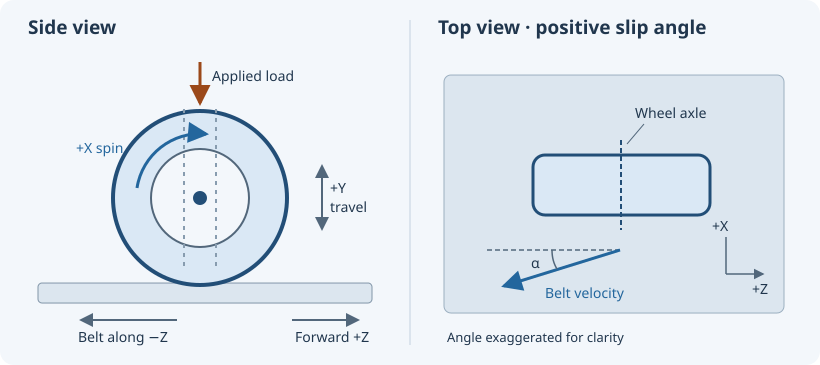
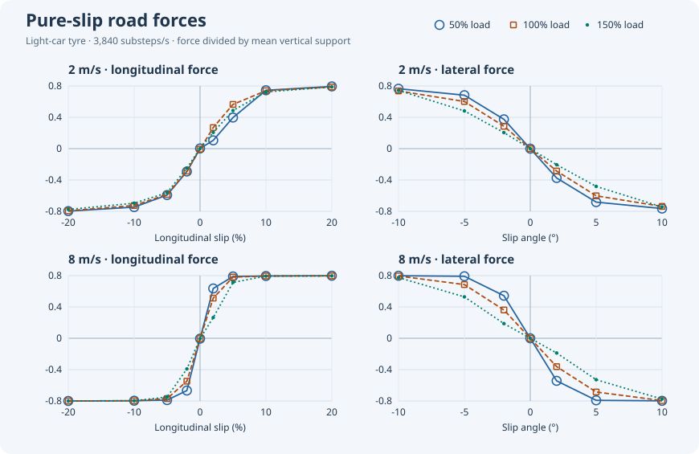
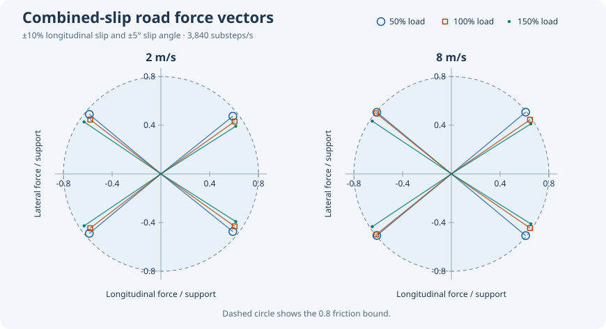

# 009 — Loaded tyre grip

The suspension corner in 008 established 2,452.5 N as the static tyre load for an evenly balanced 1,000 kg car. This experiment measures how the same sealed 150 kPa tyre builds drive, braking, and lateral force at 50%, 100%, and 150% of that load. Varying the load and speed gives the whole-car lab a reference for interpreting steering and braking as weight transfers between wheels.



## Calibrate the rolling wheel

The fixture guides a 9 kg bare rim and a 3 kg hub vertically. The two bead rings add 3.2 kg to that guided mass and spin with the rim. The remaining 4.8 kg of tyre nodes receive gravity individually. The hub follows the axle in Y, and its mass contributes no spin inertia. The load command includes the complete wheel assembly's weight. The fixture applies the target load less the free nodes' weight at the axle, leaving the existing tyre solver to account for that weight at the tread.

For each load and belt speed, settle the wheel on the stationary belt and ramp the belt to speed over half a second. Let bead torque accelerate the rim until it rolls freely. Divide belt speed by the mean spin over two settled revolutions to get the effective rolling radius. Save the complete wheel state, including the gas charge and node velocities, so every case at that load and speed starts from the same rolling baseline.

| Road load (N) | Radius at 2 m/s (mm) | Road drag at 2 m/s (N) | Radius at 8 m/s (mm) | Road drag at 8 m/s (N) |
| ---: | ---: | ---: | ---: | ---: |
| 1,226.25 | 338.14 | 1.89 | 338.26 | 5.60 |
| 2,452.50 | 337.39 | 2.25 | 337.26 | 10.68 |
| 3,678.75 | 336.51 | 4.32 | 335.98 | 17.96 |

## Set the slip

World +Y is up, +Z is forward, and +X is lateral and along the axle. With belt speed magnitude `V` and slip angle `α`, the belt velocity is `(−V sin α, 0, −V cos α)`. A positive angle gives the belt a component toward −X. For target longitudinal slip `κ`, spin the wheel about +X at `(1 + κ) V cos α / R_eff`. Using only the belt's longitudinal component in this calculation keeps `κ` at zero during a pure lateral test. Positive `κ` drives the tread backward relative to the belt and produces a road force toward +Z. Negative `κ` represents braking.

At both 2 and 8 m/s and each of the three loads, run the straight reference at 0% and 0°, then sweep ±2%, ±5%, ±10%, and ±20% longitudinal slip and ±2°, ±5°, and ±10° slip angle. Pair ±10% with ±5° in all four sign combinations. That gives 19 cases per load and speed. Each case ramps over half a second, stays at target for one second, then measures two consecutive complete revolutions that meet the settling checks.

## Read the force curves



At nominal load, +2% longitudinal slip produces 660 N at 2 m/s and 1,257 N at 8 m/s. The same slip ratio gives a larger speed difference at the faster belt. The tyre approaches the friction bound early at 8 m/s. Going from +5% to +20% adds just 38 N, from 1,915 to 1,953 N. Drive and braking magnitudes differ slightly. At 2 m/s and 2% slip the tyre produces +660 N in drive and −703 N in braking. At zero longitudinal slip and +5° the road also has a rearward component of −58 N at 2 m/s and −132 N at 8 m/s.



At nominal load and 8 m/s, +5° alone produces −1,681 N laterally. Adding +10% longitudinal slip reduces the lateral force to −1,092 N and produces +1,584 N longitudinally. Friction at each tread node shares one force limit across both directions. The magnitude of the combined mean force across the plotted cases is 0.728 to 0.794 times mean vertical support.

## Check repeatability and timestep sensitivity

The report checks rim clearance and the instantaneous horizontal road-force bound `|F_horizontal| ≤ 0.8 F_normal` at every substep. Each pair of accepted turns supports the target load within 2%, with horizontal road and axle means changing by at most 1% of that load between turns. Free rolling also checks spin repeatability within 0.5%. The final force checks use the free-rolling drag for the signed longitudinal response, require the lateral force to oppose lateral slip, and compare settled road and axle forces within 2% of target load.

All 228 cases passed at 3,840 and 7,680 substeps/s. The largest change in a mean horizontal force component between the two rates was 1.32% of requested load, below the 5% tolerance. The largest road-to-axle difference in a settled horizontal force vector was 0.29 N. These curves describe the simulated carcass and velocity-dependent friction law on this belt.

## Reproduce the checks

```sh
cargo test --workspace
cargo run -p vehicle_lab -- --drop-report
cargo run -p vehicle_lab -- --rolling-report
cargo run -p vehicle_lab -- --corner-report
cargo run -p vehicle_lab -- --grip-report
cargo run -p vehicle_lab -- --grip-report --samples
cargo run -p vehicle_lab -- --grip-lab
cargo run -p vehicle_lab -- --grip-lab --benchmark
```

The plots use `grip` rows at 3,840 substeps/s, with road forces divided by measured mean support. The sample flag adds `grip_trace` rows at 60 Hz through the ramp and settling. In the lab, use **1–3** to select the load, **V** to toggle belt speed, **Left/Right** to select a slip case, **Enter** to run it, and **Backspace** to restore the saved wheel. The windowed benchmark of the nominal-load +10%, +5° case at 8 m/s averaged 2.13 ms per fixed tick and ran at 1.001× real time on the development machine.
