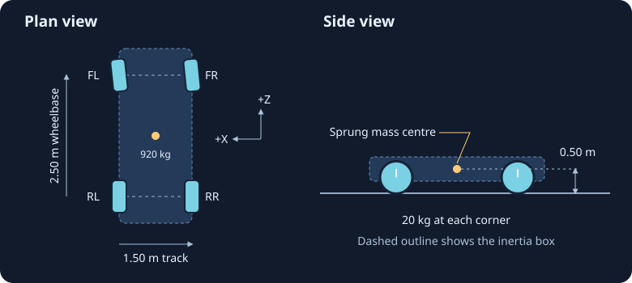
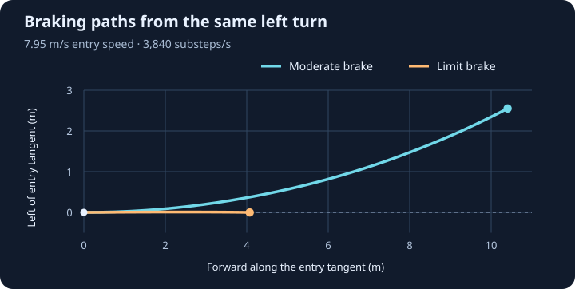

# 010 — Scripted whole-car handling

Four sealed node-and-beam tyres launch, steer, and stop a 1,000 kg car on a stationary, level road. The same car stops from about 8 m/s in **10.94 m** under moderate straight braking and **4.08 m** under limit braking. In a left turn, locked tyres shorten the stop and leave the car travelling almost along its entry tangent.



## Assemble and command the car

The 920 kg Avian chassis can translate and rotate on all axes. Its inertia comes from a uniform 3.6 × 1.5 × 0.5 m box. Each 20 kg wheel assembly consists of a 3 kg hub, a 9 kg bare rim, and an 8 kg tyre. The four springs use 30 kN/m stiffness, 2 kN·s/m damping, and 60–290 mm travel limits. The sealed tyre preset and the stationary road retain the 150 kPa initial gauge pressure and 0.8 friction coefficient used in the loaded grip experiment. [Loaded suspension](../008-loaded-wheel-and-suspension/README.md) [Loaded tyre grip](../009-loaded-tyre-grip/README.md)

The chassis starts with +Z forward, +Y up, and +X to the left. The hub slides along the suspension axis. Steering rotates the hub-side hinge frame before Avian prepares the joints for the next tick. At 6° equivalent steer, Ackermann geometry gives the left front wheel about 6.19° and the right front about 5.82° in a left turn. Both axes point towards the same turn centre on the rear axle line.

At each substep, drive and brake apply equal and opposite angular impulses to the rim and hub. The prismatic joint carries the hub reaction to the chassis. The brake opposes relative spin and limits its impulse to the amount needed to arrest the rim. The chassis angular inertia estimates the response on the hub side of the constrained pair.

Each run starts with four seconds of static settling. A proportional-integral controller applies up to 400 N·m at each rear wheel. The integral accumulates near the requested speed. The straight cases hold speed within 2% for one second before braking. The turn cases ramp to 6° over 0.5 s, then wait for two consecutive one-second windows within 2% of target speed and with mean yaw rates within 3% of one another. For braking, the driver releases rear drive, holds the steering command, and applies 250 or 1,200 N·m of brake capacity per wheel.

## Check weight transfer and stopping

After settling, each corner supports **2,452.5 N**, compresses its suspension by about **75.2 mm**, and puts the chassis centre **0.500 m** above the road. At 3,840 substeps/s, the car enters its accepted speed band after 3.43 s of launch at 4 m/s and 4.77 s at 8 m/s. Lateral drift during the straight launches stays below 0.1 mm.

| Manoeuvre at 3,840 substeps/s | Path radius (m) | Yaw rate (°/s) | Lateral acceleration (m/s²) |
| --- | ---: | ---: | ---: |
| Left at 4 m/s | 23.99 | +9.59 | +0.67 |
| Right at 4 m/s | 23.99 | −9.59 | −0.67 |
| Left at 8 m/s | 24.31 | +18.73 | +2.60 |
| Right at 8 m/s | 24.31 | −18.72 | −2.60 |

The radius uses horizontal path length divided by the absolute change in travel direction over the accepted turn window. Yaw rate measures rotation of the chassis about world +Y. The 8 m/s left turn rolls the chassis by about 0.98° and adds about 344 N to each outside wheel.

| 8 m/s left turn at 3,840 substeps/s | Front left (N) | Front right (N) | Rear left (N) | Rear right (N) |
| --- | ---: | ---: | ---: | ---: |
| Steady turn | 2,108 | 2,797 | 2,109 | 2,796 |
| Moderate braking | 2,448 | 2,867 | 2,041 | 2,454 |
| Limit braking | 2,967 | 3,057 | 1,844 | 1,932 |

The braking rows average from brake onset to 4 m/s. Each road-force sample averages the substeps in its 60 Hz tick. Braking transfers load forward. At the limit, the lateral load difference shrinks as the locked wheels slide.

| Brake case at 3,840 substeps/s | Entry speed (m/s) | Stopping distance (m) | Mean deceleration (m/s²) | Wheels that locked |
| --- | ---: | ---: | ---: | ---: |
| Straight, moderate from 4 m/s | 3.99 | 2.76 | 2.85 | 0 |
| Straight, moderate from 8 m/s | 7.95 | 10.94 | 2.87 | 0 |
| Straight, limit from 8 m/s | 7.95 | 4.08 | 6.93 | 4 |
| Left turn, moderate from 8 m/s | 7.95 | 10.82 | 2.89 | 0 |
| Left turn, limit from 8 m/s | 7.95 | 4.09 | 6.82 | 4 |

Stopping distance follows the chassis centre from brake onset to its first 60 Hz sample below 0.1 m/s, confirmed by a quarter second below that threshold. Mean deceleration uses the entry speed and the 0.1 m/s threshold. A lock begins when circumferential speed, using the 337.26 mm rolling radius measured in 009, stays below 10% of the wheel's longitudinal road speed for 0.1 s while that speed exceeds 1 m/s. The two inside tyres in the limit turn meet the condition from 0.033 s after brake onset. The outside tyres follow at 0.050 s.



From their shared 7.95 m/s entry to 4 m/s, the moderate-braking path has **108%** of the steady turn's curvature magnitude in the same direction. The limit-braking path has **−2.6%** of its signed curvature. Mean chassis yaw rates in that interval are +14.0°/s and +13.7°/s, respectively. The chassis keeps rotating after the travel direction straightens, so yaw alone would overstate how much turning the car retains under lock.

## Reproduce the checks

```sh
cargo test --workspace
cargo run -p vehicle_lab -- --corner-report
cargo run -p vehicle_lab -- --grip-report
cargo run -p vehicle_lab -- --handling-report
cargo run -p vehicle_lab -- --handling-report --samples
cargo run -p vehicle_lab -- --handling-lab
cargo run -p vehicle_lab -- --handling-lab --benchmark
```

The report checks all nine cases at 3,840 and 7,680 substeps/s. It checks every corner's static support within 2% and sag within 3 mm, positive rim clearance during the run, load transfer in the expected direction, and expected wheel lock. Mirrored radii and the corresponding stopping distances and radii at the two solver rates agree within the 5% tolerance. The largest distance change between rates was 1.26%, and the largest radius change was 0.80%. The path chart uses the `handling_chassis` samples at 3,840 substeps/s. Its horizontal and vertical axes use the same scale.

In the window, select a case with **1–9** or **Left/Right**, press **Enter** to replay, and use **Backspace** to reset. The benchmark replays case 9 with all four tyres live. On the development machine at 1,120 × 720 logical pixels with VSync disabled, it averaged **6.93 ms per fixed tick** and ran at **1.000× real time**.
