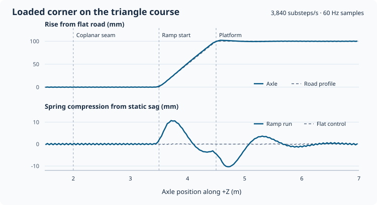

# 012 — Tyre contact on driving surfaces

The mounted tyre can now use finite world-space triangles for tread support. Each tread node queries a shared static bounding volume hierarchy along world Y. Of the faces whose XZ projection contains the node, the solver selects the nearest one above it within the configured depth. It accepts either winding and orients the normal upward. A source-index tie-break gives a single reaction at a shared edge or vertex.

The solver measures penetration along the selected normal and applies the existing one-sided spring and damper. Friction acts in the face tangent plane against predicted tangential slip, using the same regularized Coulomb limit as the flat floor. The tyre still transfers force and torque to the rim through its bead nodes.

The depth bound is a vertical distance in metres. This test uses **50 mm**. The bound lets the wheel use a lower road beneath a separated deck and limits the search to nearby faces. A tread node that moves farther below a face than this bound leaves its contact band, so callers should keep expected per-step motion and penetration within it. Use triangles representing top-side road support.

## Loaded-corner response

The 250 kg reference corner settles for four seconds and accelerates to 2 m/s. The triangle course has a coplanar join at Z = 2 m, a one-metre ramp from Z = 3.5 to 4.5 m, and a platform **100 mm** above the approach. All three runs use the same sealed tyre, spring, damper, road stiffness, and friction parameters. The ramp case samples a road normal with a backward component while the rim spins in the rolling direction.



| Substeps/s | Static triangle support (N) | Static axle height (mm) | Rolling flat axle height (mm) | Rolling platform axle height (mm) | Ramp peak spring travel (mm) | Minimum rim clearance (mm) |
| ---: | ---: | ---: | ---: | ---: | ---: | ---: |
| 3,840 | 2,452.5 | 326.13 | 325.57 | 425.57 | 10.73 | 105.15 |
| 7,680 | 2,452.5 | 326.13 | 325.57 | 425.57 | 10.72 | 105.15 |

The analytic and triangle flats agree to the precision shown. The approach seam changes support by less than 0.001 N in the 60 Hz samples. The rim clearance uses the highest road point within the rim’s forward reach to give a conservative bound on the rising course. The ramp’s maximum sampled normal penetration is 2.86 mm at both rates.

## Reproduce the checks

```sh
cargo test --workspace
cargo run -p vehicle_lab -- --surface-report
cargo run -p vehicle_lab -- --surface-report --samples
cargo run -p vehicle_lab -- --corner-report
cargo run -p vehicle_lab -- --grip-report
cargo run -p vehicle_lab -- --impact-report
cargo run -p vehicle_lab -- --handling-report
```

The surface report checks settled load within 2%, flat axle height within 2 mm of the analytic control, seam support agreement within 0.5 N, positive rim clearance, platform rise within 3 mm of 100 mm, and peak spring travel within 5 mm across solver rates. [Loaded-corner lab controls](../../user/README.md#loaded-wheel-and-suspension)
