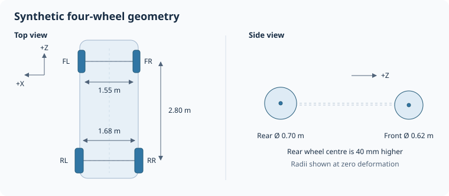

# 013 — Data-driven rigid vehicle assembly

A `VehicleSpec` describes a sprung chassis and four independent corners. The chassis stores sprung mass, a centre of mass in vehicle coordinates, and the dimensions of a uniform box for inertia. The assembly uses a collider-free rigid chassis and upright wheels with chassis-local vertical travel. Vehicle-local +Y points up, +Z points forward, and +X points left.

The spawn pose transforms the vehicle origin, which can be offset from the centre of mass. Each corner starts at its specified wheel centre and suspension length. The suspension mount in chassis coordinates is the wheel centre plus the initial length along +Y, minus the chassis centre of mass. This keeps the wheel centres and suspension anchors in the same frame when the vehicle is translated or rotated. Front and rear track are the left-to-right X distances. Wheelbase is the distance along Z between axle midpoints.

## Preparation and spawn

`VehicleSpec::prepare` validates the layout and inflates each distinct `TyreSpec` once at the requested substep rate. The tyre specification carries the five-ring rest shape, material, tread reinforcement, ambient pressure, and target gauge pressure. Preparation seals the gas charge and makes the unloaded radius available for calculating the spawn height. Every mounted wheel owns its deformation and gas charge.

`PreparedVehicle::spawn` takes an explicit world pose and analytic floor or shared triangle road. It builds all four corner bundles before creating the chassis. Errors identify the chassis field, pose field, or named wheel involved. The handles return the corners in FL, FR, RL, RR order with their spin joints for steering and torque commands. Calling `despawn` removes the rigid bodies and joints. The reference car and its incremental tyre preparation use the same code paths.

## Assembly measurements

The synthetic car has 1,010 kg of sprung mass, 19.5 kg at each front corner and 23.5 kg at each rear corner. Its centre of mass sits 35 mm left of the vehicle origin and 140 mm forward of it. The rear wheel centres are 40 mm higher than the front centres at spawn. The reference tyre material is reused with the synthetic carcass masses.



| Quantity | Front | Rear |
| --- | ---: | ---: |
| Track (m) | 1.55 | 1.68 |
| Rest tread radius (mm) | 310 | 350 |
| Rest shoulder width (mm) | 180 | 220 |
| Unloaded inflated radius (mm) | 318.43 | 362.08 |
| Spring stiffness (kN/m) | 32 | 36 |

The fixture spawns on a two-triangle floor with a 0.37 rad yaw. Its calculated weight is 10,751.8 N. The driven runs apply 6° equivalent front steer and 95 N·m to each rear wheel for two seconds. Distance is measured along the initial forward axis. Minimum clearance includes settling and driving.

| Substeps/s | Synthetic settled support (N) | Minimum rim clearance (mm) | Driven distance (m) | Reference moderate stop (m) | Reference limit stop (m) |
| ---: | ---: | ---: | ---: | ---: | ---: |
| 3,840 | 10,751.2 | 114.66 | 0.881 | 10.942 | 4.084 |
| 7,680 | 10,751.2 | 114.65 | 0.881 | 11.002 | 4.136 |

The reference car settles at 2,452.5 N per corner at both rates. At 3,840 substeps/s the braking entry speed is 7.952 m/s and measured sag across the four corners is 75.16–75.21 mm.

## Inputs for the first imported drive

Use the authored wheel centres as the four local centres and supply the common world pose independently. Map outer tyre radius and tread width to the rest tread radius and shoulder width. An authored rim radius can supply the bead radius. The approximation profile must provide missing rim dimensions, shoulder radius, bead width, masses, chassis inertia dimensions and centre of mass, suspension geometry and rates, tyre material and pressure, and drive and brake commands. Upright orientation supplies the first drive baseline for the later camber and toe comparison. [Reference car reports](../../user/README.md#run-reports-on-the-reference-car-and-track)

## Reproduce the checks

```sh
cargo test --workspace
cargo run -p vehicle_lab -- --assembly-report
cargo run -p vehicle_lab -- --corner-report
cargo run -p vehicle_lab -- --surface-report
cargo run -p vehicle_lab -- --grip-report
cargo run -p vehicle_lab -- --handling-report
```

The assembly report checks both solver rates. It compares the reference loads, sag, and 8 m/s stops with the 011 measurements. It checks synthetic wheel placement and rest dimensions before advancing physics, then checks support on all four tyres, steering geometry, driven travel, rim clearance, and cleanup. The validation test checks that missing or invalid inputs leave the live entity count unchanged.
