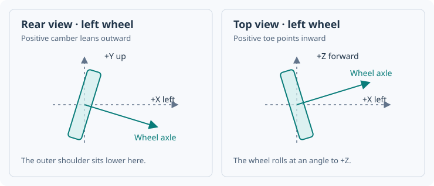

# 014 — Authored wheel alignment

A wheel can carry its authored camber and toe through the rigid assembly. The same axle sets the rim orientation, the spin constraint, and the direction of drive and brake torque. The deformable tread starts in that orientation and reacts to the road with its existing contact law.



## Wheel and joint frames

Vehicle-local +X points left, +Y up, and +Z forward. `WheelAlignment::from_axle` makes the leftward unit axle wheel-local +X. It projects vehicle up onto the wheel plane to establish the rim's initial clocking. The rim spawns at the chassis rotation multiplied by the rest alignment.

The hub shares the chassis axes and slides along chassis-local −Y. The revolute joint uses the rest alignment on its hub side and wheel-local +X on its rim side. The hub-side basis is `rotation_y(steer_rad) * rest_alignment`, so steering rotates the axle about chassis up. At zero steer the joint returns to the authored axle. These angles describe static alignment through the suspension's vertical travel.

`PreparedVehicle::with_wheel_alignments` supplies FL, FR, RL, and RR alignment in order. The default wheel basis is upright. `unloaded_tread_positions_m()` supplies the inflated tread in tyre-local coordinates for clearance calculations at the starting orientation.

## Measured tread response

For each successful triangle-road substep, `TriangleReaction::lateral_load_centre_m` weights each tread node's offset along rim-local +X by its scalar normal force. An unloaded tread returns `None` for this measurement.

The base Accord was measured on the level start surface in N-Labs Testing Facility 0.5. Positive camber leans outward and positive toe points inward. Load-centre offsets are positive toward vehicle left. Settled offsets use the final second of a five-second settle. Rolling forces are the mean absolute lateral friction reaction per wheel with centred steering at 2–4 m/s.

| Wheel | Authored camber | Authored toe | Load centre, upright → authored | Lateral force, upright → authored |
| --- | ---: | ---: | ---: | ---: |
| FL | −0.588° | 1.175° | +0.00 → +0.42 mm | 0.13 → 45.35 N |
| FR | −0.588° | 1.175° | +0.00 → −0.42 mm | 0.15 → 37.87 N |
| RL | 3.521° | 0.000° | +0.01 → +1.41 mm | 1.97 → 159.56 N |
| RR | 3.521° | 0.000° | +0.01 → −1.49 mm | 1.97 → 158.77 N |

The rear load centres shifted outward by about 1.5 mm. Both rear tyres developed lateral force while rolling with authored camber and zero rear toe. The paired simulations include the response of the whole car. The isolated checks exercise camber and toe independently on a level triangle road.

## Reproduce the checks

```sh
cargo test -p vehicle_physics --features avian wheel_alignment
cargo test -p vehicle_physics --features avian aligned_wheel_steers_and_spins_on_a_vertical_slider
cargo test -p vehicle_physics camber_shifts_settled_load_and_toe_causes_lateral_scrub
```

The joint test uses a rotated chassis and checks the steered hinge axis, positive drive spin, brake response, return to rest alignment, and vertical travel. The tyre test reverses camber to reverse the load offset, then reverses toe to reverse the signed lateral force while the rim translates straight ahead.

The imported Accord also passed the existing settle, acceleration, steering, brake, and ramp checks with authored alignment. [Imported alignment comparison](../../user/README.md#compare-wheel-alignment)
