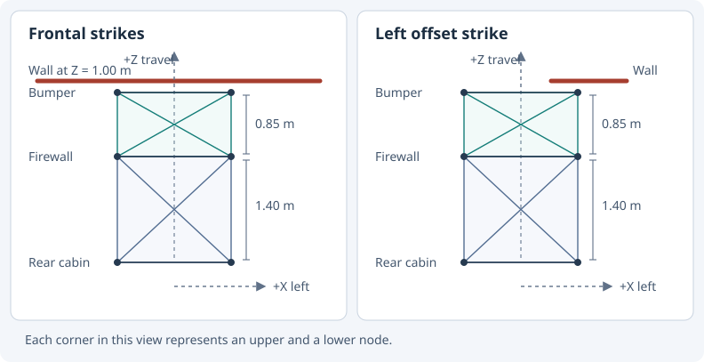

# 015 — Soft-body chassis impacts

A free node-and-beam chassis now collides with a fixed wall. A light strike stores energy in the beams and rebounds. A harder strike leaves permanent nose crush. An offset strike concentrates the crush on the struck side and rotates the cabin.



## Structure and contact

`Chassis` stores mass, world position, and velocity at each node. Each beam stores its endpoints, axial spring and damper coefficients, and a stress-free length. The substep applies equal-and-opposite beam forces and advances velocity before position. Beam history is evaluated on the contact-corrected geometry. The solver commits motion and damage together after validating the candidate. Reset restores the initial positions, launch velocities, and stress-free lengths.

The finite, frictionless wall lies at fixed world Z and faces the approaching chassis. Each node is tested along its substep path. At a crossing inside the face, the solver stops inward normal motion while preserving tangential motion. The reported impulse is the actual change in node momentum at contact. Rebound comes from unloading the beams. The fixture uses yield-only materials, so the beams stay connected as they acquire permanent changes in stress-free length.

## Fixture

The 1,080 kg chassis has four nodes at each of three stations. The bumper, firewall, and rear cabin sit at Z = 0.85, 0, and −1.40 m. The nodes span X = ±0.75 m and Y = 0.30–0.85 m. Node mass is 40 kg at the bumper, 100 kg at the firewall, and 130 kg at the rear cabin. The connected frame has 50 beams, with six within each station and sixteen between each pair of adjacent stations.

| Beams | Axial stiffness | Damping | Tension yield | Compression yield |
| --- | ---: | ---: | ---: | ---: |
| Bumper to firewall | 330,000 N/m | 3,500 N·s/m | 8% | 6% |
| Cabin and cross-sections | 2,600,000 N/m | 10,400 N·s/m | 8% | 8% |

The chassis launches along +Z in zero gravity at 3,840 substeps/s. The wall is at Z = 1.00 m and spans Y = −1 to 2 m. It covers X = −3 to 3 m for frontal strikes, X = 0.4 to 1.4 m for the left offset, and X = −1.4 to −0.4 m for its mirror.

## Results

The nose and cabin lengths are measured on each side from the mean distance between matching upper and lower nodes at adjacent stations. Residual shortening is averaged over a 0.25 s window after release in which each of the four measured lengths varies by at most 0.25 mm. Yaw was measured at the last wall impulse. Positive rebound is directed away from the wall.

| Strike | Approach / rebound | Peak nose shorten, L / R | Residual nose shorten, L / R | Residual cabin shorten, L / R | Release yaw | Yielded beams | Wall impulse along Z |
| --- | ---: | ---: | ---: | ---: | ---: | ---: | ---: |
| Light frontal | 1.000 / 0.415 m/s | 12.43 / 12.43 mm | 0.00 / 0.00 mm | 0.00 / 0.00 mm | 0.000° | 0 | −1,527.859 N·s |
| Hard frontal | 8.000 / 2.322 m/s | 109.63 / 109.63 mm | 38.42 / 38.42 mm | 0.28 / 0.28 mm | 0.000° | 8 | −11,147.238 N·s |
| Left offset | 8.000 / −1.532 m/s | 155.77 / 0.00 mm | 81.99 / −9.94 mm | 0.07 / −0.01 mm | +9.715° | 4 | −6,985.855 N·s |
| Right offset | 8.000 / −1.532 m/s | 0.00 / 155.77 mm | −9.94 / 81.99 mm | −0.01 / 0.07 mm | −9.715° | 4 | −6,985.855 N·s |

Peak cabin shortening was 1.12 mm on each side in the light strike and 8.23 mm on each side in the hard frontal strike. In the offset strikes, cabin shortening peaked at 8.56 mm on the struck side and 0.66 mm on the other side. All yielding occurred in the nose. The offset chassis retained forward speed as the unstruck side passed beside the wall.

No struck node penetrated the wall in the committed motion. The largest corrected trial depth was 2.08 mm. The measured chassis momentum change agreed with the wall impulse to within 2.1 × 10⁻¹² N·s. Reset reproduced the measurements in all four runs.

## Reproduce

```sh
cargo test -p vehicle_physics --test chassis
cargo run -p vehicle_lab -- --chassis-crash-report
```

The core tests cover elastic recovery in free flight, momentum conservation, retained beam shortening, deterministic reset, swept contact at a wall edge, and rollback after a failed step.
