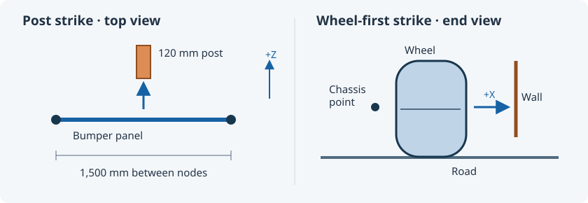

# 016 — Soft-body contact with static obstacles

The chassis can catch a narrow post on a bumper panel between its nodes. The mounted tyre can take a lateral obstacle load while the road still supports the tread.



## Contact model

`StaticCollisionMesh` indexes finite world-space triangles in a bounding volume hierarchy. A substep queries the bounds swept by the moving nodes and panels. The narrow phase checks a moving vertex against a fixed face, a fixed vertex against a moving face, and pairs of crossing edges. Shared coplanar diagonals inside the static mesh are ignored for edge tests. Contact acts on either side of a triangle and follows the approach direction.

`Chassis::step_with_static_world` advances to each impact and distributes a frictionless impulse among the local nodes using the contact point's barycentric weights and the nodes' masses. It integrates the remaining time with the corrected velocities. Beam yielding uses the contact-corrected geometry. Motion and beam history commit together after validation.

`MountedTyre::set_obstacles` includes the sidewalls and beads in the sweep. The obstacle reaction acts through the carcass at free nodes and through the returned rim force and torque at prescribed beads. The rim's prediction uses its mass and principal inertia. The caller integrates the rim and synchronizes the beads after the step. The road solver owns coplanar support contacts and continues to handle tread grip. Start swept fixtures with separated obstacle geometry.

## Fixtures and results

The chassis uses the Core 015 frame at 8 m/s and 3,840 substeps/s. The 120 mm wide post has a front face at Z = 1.00 m and a top at Y = 0.65 m. The bumper nodes are 1.50 m apart across the width. Moving the post centre to X = 0.90 m gives the miss case.

| Measure | Centred strike |
| --- | ---: |
| First contact | Bumper panel at (0.06, 0.65, 1.00) m |
| World impulse | (−60.331, +1,127.654, −10,837.367) N·s |
| Mean nose shortening after release | 37.530 mm |
| Maximum committed bumper depth across the post footprint | 0.000000 mm |
| Momentum balance error | 2.91 × 10⁻¹² N·s |

The report requires at least 5 mm of retained nose shortening with at most 0.25 mm of variation over the last quarter-second. The clipped bumper depth must stay within 0.01 mm, and the reported impulse must agree with the momentum change within 10⁻⁷ N·s. Reset repeats the result exactly. The offset case produces zero impulse.

The default five-ring tyre settles for two seconds on a triangle road at a fixed axle height of 0.31 m. The wheel then moves toward the wall along +X at 1.5 m/s, with 0.2 m/s along +Z to exercise grip. The wall starts 1.5 mm beyond the widest tyre node. The chassis point starts farther from the wall at X = 0.08 m.

| Measure | Wheel-first strike |
| --- | ---: |
| First contact substep | Shoulder node 96 at 1.823 ms |
| First chassis contact substep | 15.365 ms |
| Road normal force on the first wheel contact substep | 798.1 N |
| Obstacle impulse along X through the chassis contact substep | −44.875 N·s |
| Rim impulse along X over the same interval | −35.976 N·s |
| Largest residual overlap in the tyre's contact prediction | 0.000 mm at report precision |

The road-only replay compares normal force, friction force, and node positions with and without a duplicate floor in the obstacle mesh. The two traces agree exactly. The wheel-first check also requires positive road load on impact and limits residual predicted obstacle depth to 2 mm.

## Reproduce

```sh
cargo test -p vehicle_physics --test static_contact
cargo test -p vehicle_physics --lib obstacle
cargo run -p vehicle_lab -- --static-contact-report
```

The core tests cover oblique and overhead strikes, both windings and approach directions, a 200 m/s seam crossing, panel edge contact with mutually exterior vertices, direct bead-to-rim impulse, contact between sidewall nodes, and state preservation after a failed substep.
