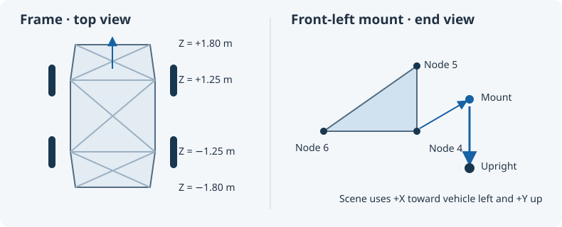

# 017 — Deformable chassis and suspension

The reference car now has a node-and-beam chassis connected to four working wheel assemblies. A wheel-first impact sends load through the suspension into the frame. When a post catches the bumper, the frame sends the impact back through the front suspension and slows the wheels.



## Mount and load path

The fixture has 16 nodes in four stations at Z = ±1.25 m and ±1.80 m. Each wheel mount uses three nodes at its axle station. The frame has 72 beams. The nose beams use 590 kN/m stiffness, 3,000 N·s/m damping, and yield at 6.5% compression or 9% extension. The structure carries 920 kg at its nodal centre of mass. Its principal moments are 2,031.80, 2,366.65, and 449.85 kg·m² about X, Y, and Z. Each corner carries the reference 20 kg of upright, rim, and tyre mass.

The mount follows a local frame derived from the three current node positions. Its slider restricts lateral motion and hub rotation, leaves one axis of spring-damper travel, and applies the existing compression and droop limits. The three-node group receives the opposite of the wheel reaction, matching the total impulse and angular impulse about the upright. Bead loads first pass through the rim and Avian spin hinge. The mount solver reads the resulting velocities in the same substep. Chassis nodes integrate gravity, beam forces, mount reactions, and static contact. The wheels respond to motion corrected by a body impact on the following substep.

Mounts, collision topology, and wheel inputs validate before spawning. A failed candidate reports the affected corner and restores wheel and tyre state from the beginning of the substep. Despawn and respawn from the same prepared structure and tyres to reset.

## Measurements

| Metric | 3,840 substeps/s | 7,680 substeps/s |
| --- | ---: | ---: |
| Mean floor load per corner | 2,452.5 N | 2,452.5 N |
| Mean settled sag | 75.22 mm | 75.21 mm |
| Driven distance along initial heading | 15.642 m | 15.642 m |
| Heading after the left turn | 0.274 rad | 0.274 rad |
| Brake distance to 0.1 m/s | 2.782 m | 2.783 m |
| Peak travel about the initial suspension length | 16.80 mm | 16.81 mm |

The report settles for four seconds, drives to 4 m/s with the reference launch controller, ramps in 6° of left steer, and applies 250 N·m of brake torque per wheel. The settling check allows 1% error in total support, 3% per corner, and 5 mm from the reference sag. It requires zero permanent beam damage. Across rates the report allows differences of 0.25 m in driven and braking distance, 0.035 rad in heading, and 5 mm in peak suspension travel.

The alignment variant measures the wheel axes relative to their moving mounts during a driven left turn. Its measured camber and toe differed from the commanded axle directions by at most 0.0002°.

The wheel-first fixture measures the first 16.7 ms of a 2.5 m/s lateral strike. The front-left wheel contacts the wall on substep 39 with 2,243.5 N of floor support. Its mount transmits −0.283 N·s along X on the first substep where the body momentum change exceeds 0.05 N·s. Total body momentum changes by −1.133 N·s along X on that substep, accounting for the other three mounts. Chassis momentum balance agrees with the external impulses within 9.1 × 10⁻¹³ N·s across the run.

The 120 mm post catches the bumper panel between its nodes on substep 87 of the 8 m/s launch. The front mounts transfer 1.838 N·s along Z to the body on substep 88. The front rims lose 0.0826 m/s of mean forward speed on that substep, before any wheel contact. The nose retains 42.01 mm of shortening. Reset reproduces the contact order, tyre loads at impact, and crush. Moving the post to X = 1.15 m gives zero contact.

The wheel-first measurement covers the initial impulse. A longer run of the same lateral wall strike reached the tyre contact iteration limit on substep 100.

## Reproduce

```sh
cargo test --workspace
cargo run -p vehicle_lab -- --coupled-chassis-report
```
