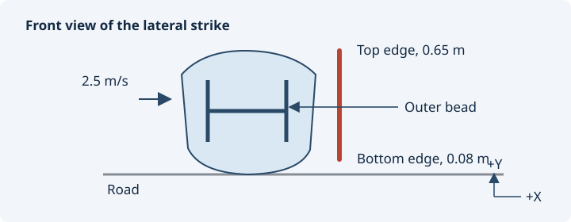

# 018 — Sustained tyre contact with static obstacles

Core 017's 2.5 m/s lateral strike hit the wall with the front-left tyre first. Extending the run exposed an iteration-limit error after 100 completed substeps at 3,840 Hz, about 26 ms. Two tyre edges sharing a node repeatedly crossed the wall's top lip. The last corrections alternated between nearly opposing normals with about 24 nm of inward travel remaining after each hit.



## Contact solve

The mounted tyre retains swept contacts for the current substep. Each contact carries an accumulated normal impulse. Projected Gauss–Seidel adjusts those impulses together, with a lower bound of zero. Free nodes respond by their point mass. Bead nodes share the rim's translation and rotation, so their impulses also affect the other beads. The solver sweeps the corrected trajectory and adds new contacts as needed. Moving panel contacts use a 1 nm endpoint distance tolerance. Node crossings against a fixed face remain strict within the existing sweep precision.

The coupled chassis checks the tyre again after integrating the hinge and suspension. Those constraints can move the bead ring through a wall that the initial tyre step cleared. The second sweep uses the staged rim pose and the combined upright and rim response, including free rim spin. Its corrections contribute to the same obstacle reaction. The solver checks the resulting pose again before committing the wheel and chassis state. Unresolved contacts still fail the substep and trigger rollback. Road triangles continue to supply tread support and grip. Static obstacle reactions act along the contact normal.

## Measurements

Both rates complete one simulated second. The report clips the deformed surface triangles to the finite wall's vertical and longitudinal bounds on every substep and measures positive depth along X directly from the geometry. It requires at most 2 mm and checks chassis momentum balance to within 10⁻⁷ N·s. Reset and replay reproduce the first wheel and chassis contact order, the last wheel contact substep, and the total wall impulse to within 10⁻⁷ N·s.

| Measurement | 3,840 Hz | 7,680 Hz |
| --- | ---: | ---: |
| Front-left first contact substep | 39 | 76 |
| Floor load at first contact | 2,243.5 N | 2,154.9 N |
| First lateral mount impulse transferred to the chassis | −0.283 N·s | −0.164 N·s |
| Last tyre contact in the measured interval | 71.09 ms | 1,000.00 ms |
| Maximum wall penetration | <0.0001 mm | 0.1204 mm |
| Total lateral wall impulse on the vehicle | −2,056.11 N·s | −1,917.37 N·s |
| Maximum chassis momentum residual | 9.05 × 10⁻¹³ N·s | 1.03 × 10⁻¹² N·s |

The faster run is still in contact at the end of the measurement. Its total vertical impulse is −325.29 N·s, reflecting contact with the finite wall edges. The slower run rebounds with a negligible vertical impulse. The bumper-first fixture retains 42.01 mm of permanent nose crush.

## Reproduce

```sh
cargo test --workspace
cargo run -p vehicle_lab -- --static-contact-report
cargo run -p vehicle_lab -- --coupled-chassis-report
```
