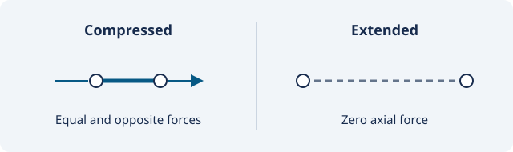

# 019 — Compression supports for chassis beams

Chassis beams can now act bilaterally or as compression supports. A support resists shortening from its stress-free length. The axial spring and damper can reduce that resistance to zero as the support unloads. Beyond its stress-free length the support carries zero force. The endpoints still receive equal and opposite forces while the support is active.



The material history updates during compression, so a yielded support unloads toward its shortened stress-free length. Extension does not create plastic set. The support law uses the same staged update as other chassis beams, so a failed step preserves the last committed length and damage.

The core also exposes the four prepared tyres through `PreparedVehicle::tyres()`. A caller can use the same inflated tyre states for rigid and deformable assemblies.

## Reproduce

The test places two 2 kg nodes 1 m apart. Moving them apart at 2 m/s produces exactly 0.4 m of extension after 0.2 s. The reverse run transfers momentum to the other node and retains more than 1 mm of plastic shortening. The pair conserves its initial 4 N·s of momentum.

```sh
cargo test -p vehicle_physics --test chassis compression_support_goes_slack_in_extension_and_yields_under_compression
```
