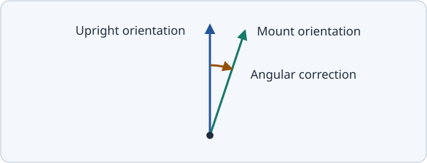

# 020 — Shortest rotation for suspension mounts

The deformable suspension estimates its mount orientation from three moving chassis nodes. Converting that frame to a quaternion can change the sign of all four components as the nodes move. Both signs encode the same orientation. Turning the relative quaternion into an axis and angle with a negative scalar component could send the upright almost a full turn. During one stationary settle, this produced about 4,776 rad/s of yaw at the front-left rim and collapsed its tyre chamber.

The angular constraint now chooses the sign of the relative quaternion that gives an angle of at most π radians. Its correction is expressed about the world-space rotation axis. A small change in mount orientation produces a small correction whichever quaternion sign the frame conversion returns.



## Reproduce

```sh
cargo test -p vehicle_physics --features avian suspension_orientation_error_is_independent_of_quaternion_sign
cargo run -p vehicle_lab -- --crash-report
```

The unit test applies a relative rotation of 0.001 rad about world +Z to an upright already rotated about +Y. Flipping the sign of either orientation must return the same correction. The lab report starts by settling all four tyres on the bundled track before the wall strike and reset replay.
