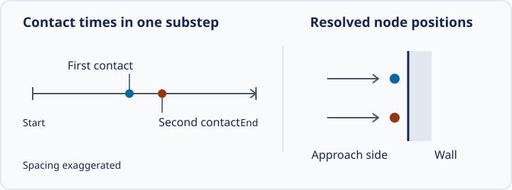

# 021 — Simultaneous wall contacts

Two corners of a moving chassis can reach a wall during the same substep. The sweep used a tolerance to break ties between close contact times. A later hit could win that comparison, advancing the earlier node beyond the plane. Even when both times are identical, advancing along an oblique trajectory can place an unresolved node just past the plane through rounding. The next sweep then sees the node moving away from the plane. In the bundled strike, the lower front corner on source node 9 crossed about 200 mm past the wall near peak impact, and about 147 mm remained across it at the last frame.

When the chassis advances to a contact, its sweep now chooses the earliest computed time and breaks ties by feature and triangle index only when the times are equal. When a node is moving away from the plane and starts within 0.1 nanometres of it, a crossing a rounding error before the start is handled at time zero. The contact point is projected onto the plane so the existing position correction can restore clearance on the approach side. The tyre solver still repeats its sweeps from the original positions across the full substep and can use the contact feature to break near ties.



## Reproduce

```sh
cargo test --locked -p vehicle_physics --test static_contact
cargo run --locked -p vehicle_lab -- --crash-report
```

The core tests cover two nearly simultaneous nodes at an axis-aligned wall and two simultaneous nodes at an oblique wall. The bundled strike checks all 121 chassis and rendered body frames against the wall plane. The maximum apparent penetration is 0.003 mm with world transforms converted to f32 for rendering. The nose retains about 162 mm of shortening and the peak chassis rebound speed is 0.59 m/s.
