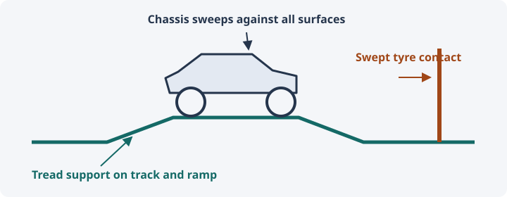
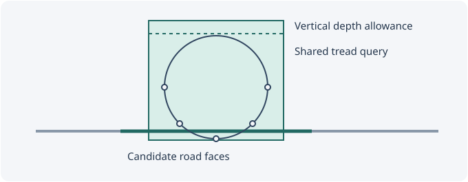
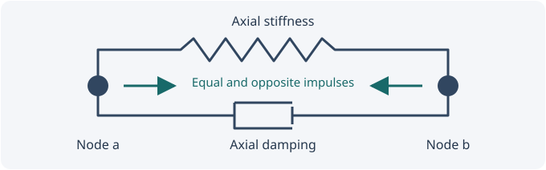

# 022 — Deformable driving

This milestone makes the deformable chassis usable for ordinary driving. The same vehicle can settle on its tyres, drive up a ramp, and transfer impact loads through the body or wheels. Road support, sweep filtering, the stiff beam solve, and batched tread queries address the stability and cost of running those systems together.

## Tread support and obstacle contact

Using the same swept mesh for chassis and tyres made the ramp responsible for both tread support and swept contact. During a powered climb, those responses could conflict and exhaust the front-right tyre's contact iteration limit. Sweeping the whole tyre against the road also took most of the tick budget on level ground.

`PreparedDeformableVehicle::spawn_with_obstacles` accepts separate chassis and tyre meshes in world metres. The reference scene uses the full terrain for chassis sweeps, the wall for tyre sweeps, and the level track and ramp for tread support. The original `spawn` method supplies the same mesh to both chassis and tyres.



The tyre and chassis solvers check the bounds of the whole swept surface against obstacle face bounds before sweeping individual nodes and panels. The tree can reject empty lanes even when distant barriers span the track. Bounds checks also exclude distant fixed vertices and edges before computing panel contact times, with padding for the solver's edge tolerance. Rollback snapshots share tyre topology, beam material data, and obstacle geometry. Each snapshot holds its own node, pressure, and damage state.

Tread nodes on one tyre also used to traverse much of the same road tree. The mounted solver now bounds the tread and extends those bounds upward by the allowed contact depth. One tree walk gathers candidates, then each node applies the same depth test, winding handling, and triangle-index tie break as a single-point query. If the candidate set fills the stack buffer and more faces remain, the solver falls back to per-node lookups.



## Stiff chassis beams

A light node connected to several stiff, damped beams could force the explicit solver to raise the substep rate for the chassis, tyres, suspension, and contact, even while parked. A project-owned fixture with 69 sprung nodes and 483 beams required 52,320 substeps per simulated second.

Configured driving uses an implicit beam solve when the explicit rate exceeds the 3,840 substeps/s used for tyre and suspension coupling. The solver linearizes each beam along its current axis and uses the authored stiffness and damping to solve for the next nodal velocities. The matrix contains positive node masses and a nonnegative axial contribution from each active beam. A compression support releases when its calculated impulse would pull in tension.



The solver uses the previous substep's change in velocity as its initial estimate and checks convergence against the current residual. Suspension and contact use the trial velocities on the same substep. Positions and beam damage commit after the sweep succeeds, so invalid geometry or a failed solve leaves the last committed chassis state available. The explicit mode remains available for bundled crash cases and callers of the original API.

## Reproduce

```sh
cargo test --locked -p vehicle_physics --features avian
cargo run --locked --release -p vehicle_lab -- --deformable-drive-report
```

The core tests check a stiff two-node beam against its analytic result, including momentum conservation and compression support release. They also compare batched and individual road lookups across seams, stacked roads, and buffer overflow. The report uses project-owned fixtures to check settlement, permanent beam change, throttle, steering, braking, reset, a loaded ramp crossing, and both impact orders.

- **Ramp.** The four wheels gain 0.560–0.561 m of height under load.
- **Tyre-first strike.** In a 5 m/s lateral launch, the right-rear tyre hits at substep 620 and the right-front at 625. The chassis clears the wall, the mount transfers up to 52.9 N·s along the approach axis, and apparent tyre penetration stays below 0.002 mm.
- **Body-first strike.** The chassis hits at substep 1464 and the tyres clear the wall. The rendered nose retains 162 mm of crush and the chassis rebounds at 0.59 m/s.
- **Release timings.** On a Windows machine with a Ryzen 7 5800X3D, the 483-beam fixture's median idle tick fell from 130 ms to about 10 ms. The larger fixture with 242 sprung nodes, 1,867 beams, and 256 scattered barriers completed 600 ticks in 9.17 s in the same set of measurements, including mesh sampling and report checks.

[Reference driving and benchmark commands](../../user/README.md#drive-on-the-reference-track) · [Configured driving](../../user/README.md#use-your-own-terrain-and-vehicle)
